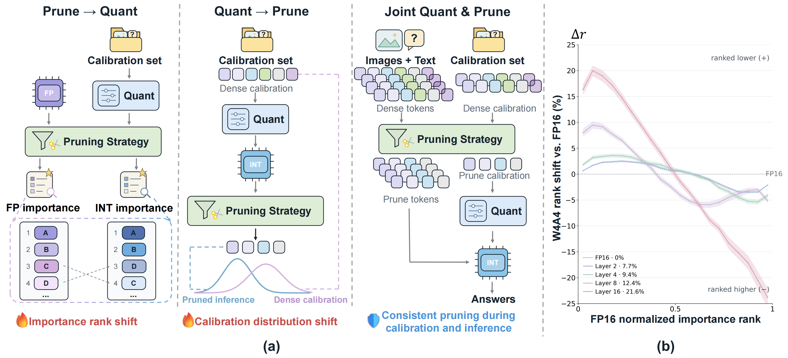

# P4Q: Co-designing Token Pruning and Quantization for Vision-Language Model Acceleration
The code repository contains the code for [P4Q: Co-designing Token Pruning and Quantization for Vision-Language Model Acceleration.](https://arxiv.org/abs/2609.34867)

## Abstract
Vision language models have achieved strong performance across a wide range of multimodal applications, yet their substantial computational and memory costs hinder efficient deployment. Visual token pruning and post-training quantization reduce inference overhead along two complementary dimensions, namely sequence length and numerical precision. Existing workflows typically optimize these techniques independently or apply them sequentially. Their distinct optimization objectives leave critical interactions unaddressed and constrain the achievable compression performance. We revisit these designs and present P4Q, a practical co-design framework that jointly optimizes visual token pruning and low-bit quantization for efficient VLM inference. First, P4Q introduces a quantization-aware visual token selection strategy before the LLM. It applies fake quantization to copies of the features produced by the projector and selects visual tokens using statistics computed from these fake-quantized features, thereby conditioning the selector’s feature-based decisions on simulated low-bit perturbations. Second, P4Q introduces a pruning-aware quantization calibration strategy. It uses the same selection strategy as pruning to calibrate the quantized model on the retained-token distribution, thereby aligning the calibration process with the pruned execution path used during deployment. By coupling these two components, P4Q achieves substantial inference speedups while maintaining comparable task performance, resulting in a better efficiency-accuracy trade-off than independently optimized pipelines. For instance, on LLaVA-NeXT, P4Q achieves an average end-to-end inference speedup of 2.8× across eight distinct test sets, while retaining higher accuracy than prior compression and quantization methods.


## Usage
Environment Setup:

```
git clone https://github.com/respACz/P4Q.git
cd P4Q
conda create -n P4Q python=3.10
conda activate P4Q
bash set_env.sh
```

Then follow the [LLaVA evaluation guide](https://github.com/haotian-liu/LLaVA/blob/main/docs/Evaluation.md) to prepare [ScienceQA (Train)](https://github.com/SAI-Lab-NYU/QSVD/blob/main/myllava/docs/QSVD_DATA.md).

Calibration and evaluation:

```
bash run.sh
```

## Citation
```
@article{jing2026p4q,
  title={P4Q: Co-designing Token Pruning and Quantization for Vision-Language Model Acceleration},
  author={Haizhao Jing and Zhenhao Shang and Haokui Zhang and Rong Xiao and Peng Wang},
  journal={arXiv preprint arXiv:2609.34867},
  year={2026}
}
```

## Acknowledgements
This project is based on the work of the following projects:

- [FlatQuant](https://github.com/ruikangliu/FlatQuant)

We are grateful for the contributions provided by these projects.
